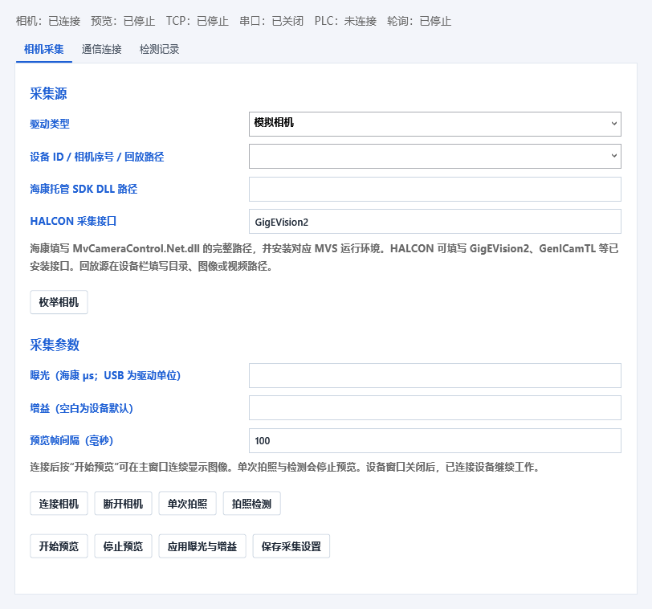

# VisionWorkbench

一个用于学习完整工业视觉软件开发的 C# 桌面项目。采用 **.NET 10 / WPF / HALCON 24.11**，少量 OpenCvSharp 工具用于练习。界面围绕顺序检测流程、图像、参数和结果展开，并提供相机采集、设备通信、结果追溯、AI 聊天与本机 Harness 工具接口。


## 当前功能

- 传统顶部菜单、分类算子库与顺序流程；图像缩放、矩形/圆形 ROI、原图与结果切换。
- 21 个视觉算子：17 个 HALCON 工具和 4 个 OpenCV 练习工具。
- HALCON 阈值、均值/中值/高斯、反转、锐化、开闭运算、填孔、边缘幅度、区域分析、灰度统计、形状/NCC 匹配和区域尺寸测量。
- HALCON 直线与圆测量模型：卡尺取边、亚像素拟合、有效卡尺比例、尺寸上下限和结果叠加。
- OpenCV 灰度、高斯、中值、Canny。
- 整条流程或运行到指定步骤；OK/NG、指标、耗时和错误记录。
- JSON 方案及配套图像、模板资源保存；文件夹批量检测和 CSV 导出。
- 相机统一接口：海康 MVS SDK 实例、HALCON 工业接口、OpenCV USB、文件/视频回放与模拟采集。
- 单次拍照、后台实时预览、拍照检测；窗体使用 CommunityToolkit 消息总线同步。
- TCP/IP 和普通串口 JSON 指令；NModbus 实现 Modbus TCP/RTU、PLC 触发与 OK/NG/错误回写。
- 检测追溯、NG/全部图像保存、历史指标与 CSV 导出。
- 10 个固定 AI/Harness 工具：查看流程/设备、修改参数和 ROI、控制已连接相机预览、拍照检测并读取真实结果。
- 带本次会话认证的 loopback HTTP Harness；与聊天和界面使用同一业务控制器。

当前为 0.3 版学习工作站，串起“采集 → 检测 → 通信回传 → 追溯”。同时保留明确边界：一台活动相机、顺序流程；未包含多相机同步、物理标定、插件市场或 AI 生成算法代码。海康适配已写入，但本机没有 MVS SDK/实机，不能将离线检查视为现场验收。

## 环境与启动

需要 Windows x64、[.NET 10 SDK](https://dotnet.microsoft.com/download/dotnet/10.0)，以及用户自行安装并合法授权的 [MVTec HALCON 24.11](https://www.mvtec.com/products/halcon)。HALCON 安装目录应包含 `bin/dotnet35/halcondotnet.dll` 和 `bin/x64-win64`。本仓库不提供 HALCON 安装包、商业 DLL 或许可证。

在 PowerShell 中设置本次会话的安装路径，然后启动：

```powershell
$env:HALCONROOT = 'C:\Program Files\MVTec\HALCON-24.11-Progress'
.\scripts\run.ps1
```

路径以本机实际安装为准。脚本先构建，再启动程序。首次构建会通过 NuGet 还原 OpenCvSharp、Microsoft.Extensions.AI 等依赖。

也可以直接使用 SDK：

```powershell
dotnet build .\src\VisionWorkbench\VisionWorkbench.csproj -c Debug
dotnet run --project .\src\VisionWorkbench\VisionWorkbench.csproj --no-build
dotnet publish .\src\VisionWorkbench\VisionWorkbench.csproj -c Release -r win-x64 --self-contained false -o .\artifacts\publish
```

发布目录仍依赖目标机器的 .NET 10 Desktop Runtime、HALCON 运行环境和有效许可。发布输出可能包含构建复制的 HALCON 托管库，分发前须按 MVTec 许可检查；不要将整个输出目录上传公开仓库。

启动后点击“示例”，再点击“运行”。默认示例包含阈值分割和区域分析，预期检测到 3 个区域、结果为 OK。选择工具后可修改参数；模板工具先绘制 ROI，再点击“从当前 ROI 创建模板”。保存方案时，请同时保留同名 `.assets` 文件夹。

也可打开仓库内的 `samples/三零件计数.json` 或 `samples/测量模型方案.json`。菜单“模型 → 加载直线与圆测量示例”可直接体验卡尺拟合；配套图像为本项目生成的简单几何图形。


## 采集、通信与追溯

通过“设备 → 设备与通信设置”配置。离线体验：先加载“示例”流程，选择“模拟相机”并连接，再“开始预览”或“拍照检测”。实时预览只采图；一次拍照检测会停止预览、采集新帧并运行当前流程。

海康作为具体 SDK 实例，填写 MVS 兼容托管库 `MvCameraControl.Net.dll` 路径并枚举序列号。其他品牌可实现 `IFrameSource` 并用 `FrameSources.Register` 注册，HALCON 通用接口可连接其支持的设备。厂商 SDK 与驱动由用户安装，不上传仓库。

TCP/串口接受 `STATUS` 和 `TRIGGER` JSON 行请求；Modbus TCP/RTU 轮询触发寄存器，并回写完成标记、OK/NG/错误、序号和耗时。设备参数独立保存，不随方案共享。程序启动不会自动连接硬件。

[采集、海康接入与消息总线](docs/Acquisition.md) · [通信协议与寄存器表](docs/Communication.md) · [实际复用与源码参考](docs/References.md)



## AI 与 Harness

“AI 助手 → 连接设置”配置兼容 OpenAI Chat Completions 工具调用的 API 地址、模型和 API Key。兼容服务必须实际支持工具调用。API Key 使用 Windows DPAPI 当前用户加密，设置存于 `%LOCALAPPDATA%\VisionWorkbench\ai-settings.json`。

聊天发送文本、工具定义、流程参数、ROI、设备状态和执行结果；不会自动发送图像字节。项目名称、工具名称和错误文本也可能随工具结果传给模型，请使用适合公开测试的材料。模型费用由所选服务产生。可以用“停止”取消请求；已经完成的工具修改会保留。工具调用最多执行 8 轮，HALCON 单个算子通常在返回后才能响应取消。

[Harness 接口与调用示例](docs/Harness.md) · [结构与数据流](docs/Architecture.md)

## 验证

```powershell
.\scripts\check.ps1
```

脚本构建并分别运行 `--check` 和 `--ui-smoke`，生成物放在已忽略的 `artifacts` 下。算法检查和界面冒烟检查不需要模型密钥；它们不能代替真实模型服务、真实设备或长期运行验证。

验证记录见 [验证说明](docs/Validation.md)。检查包含真实 HALCON/OpenCV 运算、方案重开、ROI 范围、模板匹配、批量 CSV、取消、HTTP 工具认证，以及通过本机协议桩执行的完整聊天工具调用。相机、通信与完整闭环的具体证据见验证记录；真实云模型连接需要另行配置后验证。

## 当前边界

- 内部统一使用 8-bit 灰度图；彩色输入会转灰度，其他位深会缩放并转换。
- ROI 支持轴对齐矩形和圆，坐标使用原图外接框；圆形宽高相等。测量输出像素，不包含物理尺寸标定。
- 区域尺寸工具测量亮区域的轴对齐外接矩形，不是亚像素卡尺。
- 直线/圆测量模型使用 HALCON Metrology API；ROI 定义初始几何，卡尺会读取几何两侧的完整原图。直线初始方向为水平；模型根据保存的 ROI 和卡尺参数在运行时重建。
- 模板保存为裁剪图，运行时创建形状模型；返回位置、角度、分数，预览框只是轴对齐示意。
- 后续步骤接收当前图像；统计和匹配不替换图像。预览展示最终图像及最后执行步骤的叠加结果。
- 批量处理逐张运行同一流程并导出 CSV；不递归搜索子目录，也不切换当前工程的源图和预览。批量结果查看 CSV 与日志。

## 许可与参考

本项目自行编写的应用代码使用 [MIT License](LICENSE)。HALCON 是 MVTec 的商业产品，不受本项目 MIT 许可覆盖。OpenCV、OpenCvSharp、Microsoft.Extensions.AI 及其传递依赖分别遵循各自许可证，发布时应保留适用声明。

协议实际复用 NModbus，消息总线复用 CommunityToolkit.Mvvm；第三方许可见 `licenses/`，源码阅读与复用说明见 [参考记录](docs/References.md)。

产品方向参考 [OpenVisionLab](https://github.com/Noah8218/OpenVisionLab) 的视觉工作台思路；本项目采用更小的顺序流程界面，自行实现应用代码。VisionPro、HALCON 等产品名称的商标和版权属于各自权利人。
