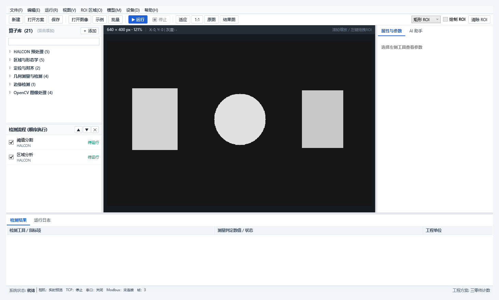
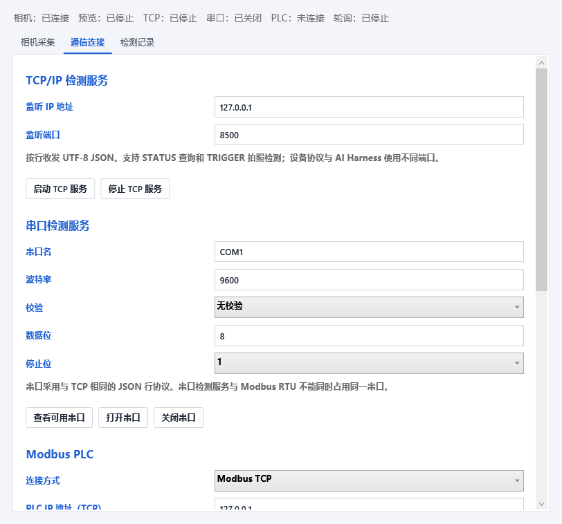
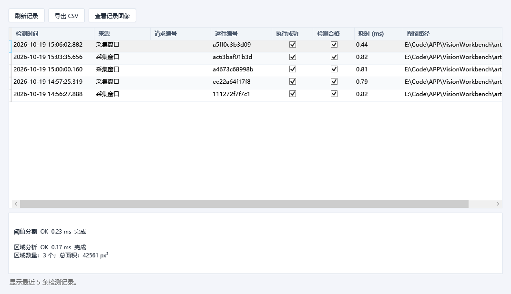

# 0.3 版验证记录

验证日期：2026-10-19。

环境：Windows x64，.NET SDK 10.0.301，HALCON 24.11，OpenCvSharp 4.13.0.20260627，NModbus/NModbus.Serial 3.0.83，CommunityToolkit.Mvvm 8.4.2，System.IO.Ports 10.0.0。

Release 构建为 0 警告、0 错误；55 项集成检查和 6 项界面检查全部通过。`scripts/check.ps1 -Configuration Release` 已运行算法与界面进程，两者均退出 0。

## 集成检查

1. 模拟相机连接、单帧、动态场景与参数。
2. 连续采集、重复启动、停止重启、断开与竞争保护。
3. 文件序列回放、循环与实时预览。
4. 实际 AVI 视频解码与循环。
5. 真实 HALCON File Framegrabber 连续采图。
6. 无效采集源明确失败，海康 SDK 状态与实机边界。
7. 连接失败后恢复连接。
8. 注入采集异常后自动断开、停止与重连。
9. TCP 真连接：分帧、粘包、多请求、异常隔离。
10. TCP 请求上限、停止、重启与空闲连接取消。
11. NModbus TCP：真实主从 FC03、FC16 与并发串行化。
12. Modbus 真实断线与无响应超时。
13. 串口枚举与关闭生命周期（物理串口及 RTU 待设备验证）。
14. CommunityToolkit 数据总线发布与窗体退订。
15. 实时预览到内存采图、HALCON检测、存图及方案重开。
16. 真实TCP触发：采图、算法、请求去重、报告回传与追溯CSV闭环。
17. 执行中的同编号并发请求仅采图一次并共享结果。
18. 真实Modbus主从：OK、NG、采集错误回写及触发保持去重。
19. 相机未连接时拒绝远程检测并保留错误状态。
20. 执行中关闭：取消采集、归还互斥锁并释放设备。
21. HALCON 区域分析。
22. 方案及图像资产重开。
23. 检测 NG 与执行失败区分。
24. 空区域正常判定。
25. OpenCV 滤波与 HALCON 混合流程。
26. HALCON 与 OpenCV 的 ROI 局部处理。
27. 矩形 ROI 与像素测量。
28. 形状模板训练、匹配与重开。
29. 圆形 ROI 真正裁域及方案持久化。
30. 圆形ROI阈值到区域分析数据流。
31. 真实算子输出 halcon.median。
32. 真实算子输出 halcon.gaussian。
33. 真实算子输出 halcon.invert。
34. 真实算子输出 halcon.emphasize。
35. 真实算子输出 halcon.open。
36. 真实算子输出 halcon.close。
37. 真实算子输出 halcon.fill。
38. 真实算子输出 halcon.edges。
39. 真实算子输出 opencv.canny。
40. 真实算子输出 opencv.median。
41. HALCON/OpenCV 圆 ROI 局部滤波。
42. 区域及边缘算子ROI外清零。
43. 灰度统计已知图像。
44. NCC真实训练、定位与重开。
45. 圆形模板PNG域保留。
46. HALCON直线测量模型真实拟合：有效卡尺拟合线段 99 px。
47. HALCON圆测量模型中心与直径精度：圆直径 69.91 px。
48. 完整测量示例及方案重开：圆直径 139.75 px。
49. 测量模型无边缘正常NG。
50. 原图结果切换与新建方案。
51. 工具注册、参数错误、ROI 边界与真实执行。
52. HTTP Harness 认证、发现与流程调用。
53. 文件夹批量检测及 CSV。
54. 取消后恢复。
55. 聊天工具调用协议：本机协议探针通过：3 次 Chat Completions 请求，参数 min=120，真实流程 OK，工具结果回传与运行编号一致。。

直线测量的长度是有效卡尺间的拟合线段，并非工件总边长。70 px 合成圆测得 69.91 px；约 140 px 圆测得 139.75 px。这些是合成图结果，不代表现场测量精度。

## 界面检查

1. 中文传统菜单栏与完整分类算子目录。
2. 真实 WPF 窗口、工具列表与检测结果。
3. 参数绑定与结果失效。
4. 中文 AI 页面和最小窗口布局。
5. 圆ROI、测量模型参数及拟合结果界面。
6. 设备窗、数据总线实时预览、AI采图、通信配置与追溯记录界面。

实际查看了主窗、最小窗口、测量模型、实时预览、设备设置、通信和记录截图；记录窗默认选中一条报告，显示详细指标。附带 PowerShell TCP 客户端脚本另用本机真实 TCP 连接验证收发。

## 验证边界

- 模拟相机、图像目录、AVI 回放、真实 HALCON File 采集：已验证。
- TCP/Modbus：真实本机套接字通信；Modbus 为 NModbus 主站连接本机 NModbus 从站，闭环包含 OK/NG/采集错误回写和采集中停止。
- 海康 MVS：实现了兼容 SDK 的真实调用适配，但本机没有 SDK 或相机，未完成加载真实程序集和实机取帧。
- USB、GigE、GenICam、物理串口、RS-485 与 Modbus RTU：代码已接入并编译；没有物理设备，未做现场联调。
- 串口只测试枚举和生命周期，不能以此证明字节已到达设备。
- 云模型：本机协议桩已验证工具调用链；未连接真实云模型。
- 未开展产线精度、吞吐量、多日稳定性或真实设备掉线恢复验收。

运行报告、原始审阅结果和参考仓库留在忽略的 `artifacts` 下；公开仓库只保留本应用截图、生成的几何图形示例和验证说明。
