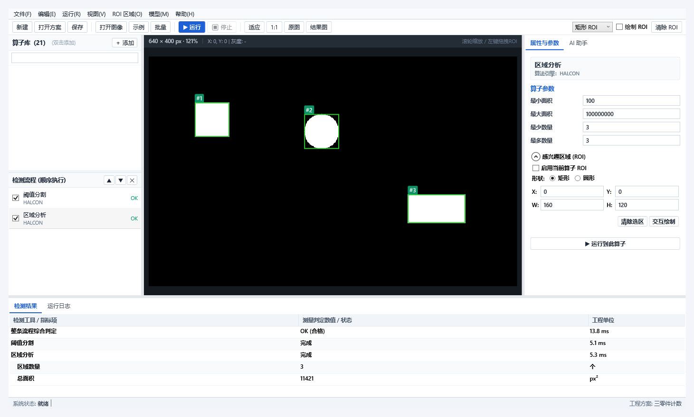
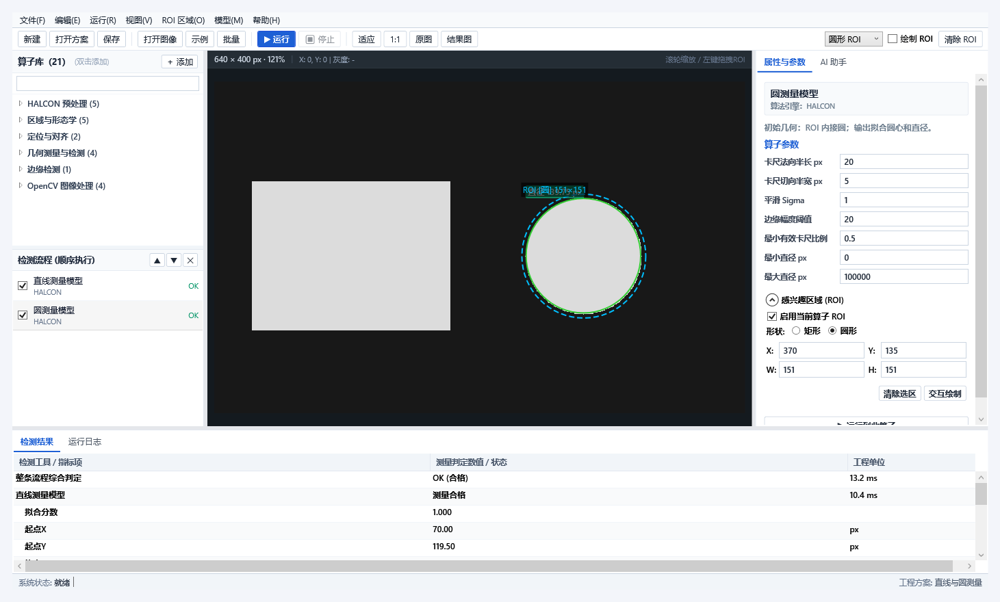

# 0.2 版验证记录

验证日期：2026-10-19。

环境：Windows x64，.NET SDK 10.0.301，HALCON 24.11，OpenCvSharp 4.13.0.20260627。

执行 `scripts/check.ps1 -Configuration Release`，构建为 0 警告、0 错误；35 项集成检查和 5 项界面检查全部通过，两组进程均退出 0。

## 集成检查

1. HALCON 区域分析。
2. 方案及图像资产重开。
3. 检测 NG 与执行失败区分。
4. 空区域正常判定。
5. OpenCV 滤波与 HALCON 混合流程。
6. HALCON 与 OpenCV 的 ROI 局部处理。
7. 矩形 ROI 与像素测量。
8. 形状模板训练、匹配与重开。
9. 圆形 ROI 真正裁域及方案持久化。
10. 圆形ROI阈值到区域分析数据流。
11. 真实算子输出 halcon.median。
12. 真实算子输出 halcon.gaussian。
13. 真实算子输出 halcon.invert。
14. 真实算子输出 halcon.emphasize。
15. 真实算子输出 halcon.open。
16. 真实算子输出 halcon.close。
17. 真实算子输出 halcon.fill。
18. 真实算子输出 halcon.edges。
19. 真实算子输出 opencv.canny。
20. 真实算子输出 opencv.median。
21. HALCON/OpenCV 圆 ROI 局部滤波。
22. 区域及边缘算子ROI外清零。
23. 灰度统计已知图像。
24. NCC真实训练、定位与重开。
25. 圆形模板PNG域保留。
26. HALCON直线测量模型真实拟合：有效卡尺拟合线段 99 px。
27. HALCON圆测量模型中心与直径精度：圆直径 69.91 px。
28. 完整测量示例及方案重开：圆直径 139.75 px。
29. 测量模型无边缘正常NG。
30. 原图结果切换与新建方案。
31. 工具注册、参数错误、ROI 边界与真实执行。
32. HTTP Harness 认证、发现与流程调用。
33. 文件夹批量检测及 CSV。
34. 取消后恢复。
35. 聊天工具调用协议：本机协议探针通过：3 次 Chat Completions 请求，参数 min=120，真实流程 OK，工具结果回传与运行编号一致。。

直线测量的长度是有效卡尺间的拟合线段，并非整个工件边长。70 px 合成圆测得 69.91 px；完整示例中的约 140 px 圆测得 139.75 px。以上只说明这些合成图上的运行结果。

## 界面检查

1. 中文传统菜单栏与完整分类算子目录。
2. 真实 WPF 窗口、工具列表与检测结果。
3. 参数绑定与结果失效。
4. 中文 AI 页面和最小窗口布局。
5. 圆ROI、测量模型参数及拟合结果界面。

算子目录核对了 21 个不重复的工具、中文菜单、搜索展开与清空搜索恢复。实际窗口截图已检查默认布局、最小窗口、AI 页及测量参数页。

检查报告与其余截图由脚本生成到 `artifacts`，不提交运行缓存。

## 未验证项

未连接真实云模型或工业相机/PLC，未开展产线精度、吞吐量与长期稳定性测试。协议桩只验证客户端协议与工具执行链路，不代表真实模型的决策质量。
